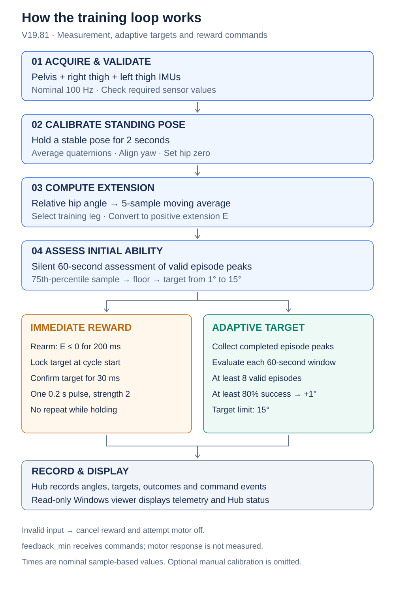

# IMU Hip Extension Training and Feedback

**Developed by:** [Yknighter](https://github.com/Yknighter) and [Wai-Hang Kwong](https://github.com/PKwong86)  
**Affiliation:** Department of Rehabilitation Sciences, The Hong Kong Polytechnic University / Gait Analysis Laboratory

The current release is **V19.81** for SageMotion Hub, with a read-only Windows live viewer.

**Downloads:** [Hub App ZIP](versions/current/IMU_Hip_Extension_Feedback_v1_19_81vibrant.zip) · [Windows viewer ZIP](versions/current/Fast_IMU_Training_Viewer_v19_81.zip)

[简体中文](README.zh-CN.md)

## Project logic and logic map

Three posture IMUs → stable standing calibration → relative hip angles → initial ability assessment → one short pulse per qualifying extension. Completed episode peaks drive subsequent target progression.

[Full English explanation](docs/project-logic.md) · [完整中文逻辑说明](docs/project-logic.zh-CN.md)

[Open full-size diagram](docs/assets/project-overview.en.svg)

## What changed in V19.81

- App version/build changed to `1_19_81vibrant` / **901810**.
- The streamed sensor list is now `right_thigh`, `left_thigh`, and `pelvis`; `feedback_min` is assigned separately under **feedback**.
- Vibration commands now use `feedback_vibration_on/off()`.
- The feedback node receives commands only. Its accelerometer is not streamed, so command records are not physical vibration measurements.
- Hip-angle closed-loop reward triggering and adaptive target updates are retained from V19.8.
- [Full V19.8 → V19.81 change log](versions/current/CHANGELOG.md).

## Setup

Import the App ZIP into the Hub. Assign the three posture IMUs under **sensors** and `feedback_min` under **feedback**. Do not assign one physical node to both lists. The Hub SDK must support `feedback_vibration_on()` and `feedback_vibration_off()`.

Extract the viewer ZIP on the Windows computer and run `start_v19_81_viewer.cmd`. The viewer reads App telemetry and Hub status over WebSocket; it does not connect directly to IMUs or `feedback_min`, and it does not send vibration commands.

A command event means the App requested vibration; it does not confirm physical motor response. V19.81 does not collect acceleration or RMS from the feedback node.

## Viewer setup

The viewer needs Python 3, Tkinter, and `websocket-client`. The launcher first tries `C:\Python39\python.exe`, then `python` on PATH. Default Hub address: `192.168.137.1`; WebSocket port: `5678`; status API port: `80`.

## Source and history

- [Current V19.81 package, source, and instructions](versions/current/).
- [Previous V19.7 package](versions/v19.7/).
- [Experimental V19.9v candidate](probably-solve/v19.9v/); it still requires hardware validation.
- Current files use the stable `versions/current/` path. Previous V19.8 files remain accessible in Git history.

This publication does not claim V19.81 offline tests or hardware validation. [Repository license](LICENSE.md)

## Contributors

- [Yknighter (@Yknighter)](https://github.com/Yknighter)
- [Wai-Hang Kwong (@PKwong86)](https://github.com/PKwong86)
