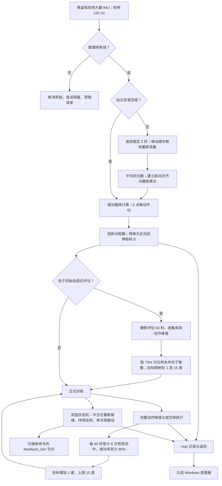

# IMU 髋关节后伸训练与反馈

**Developed by:** [Yknighter](https://github.com/Yknighter) and [Wai-Hang Kwong](https://github.com/PKwong86)  
**Affiliation:** Department of Rehabilitation Sciences, The Hong Kong Polytechnic University / Gait Analysis Laboratory

SageMotion Hub 当前正式版为 **V19.81 App**，配套只读 Windows 实时查看器。

**下载：**[Hub App ZIP](versions/current/IMU_Hip_Extension_Feedback_v1_19_81vibrant.zip) · [Windows 查看器 ZIP](versions/current/Fast_IMU_Training_Viewer_v19_81.zip)

[English](README.md) | **简体中文**

## 项目逻辑与流程图

三颗姿态 IMU → 稳定站立校准 → 相对髋角 → 初始能力评估 → 后伸达标单次短震动；完整动作峰值用于后续目标升级。

[完整中文逻辑说明](docs/project-logic.zh-CN.md) · [English logic map](docs/project-logic.md)

## V19.81 修改内容

- App 版本和 build 更新为 `1_19_81vibrant` / **901810**。
- 推流传感器调整为 `right_thigh`、`left_thigh`、`pelvis` 三颗；`feedback_min` 单独放在 **feedback** 列表。
- 震动启停 API 改为 `feedback_vibration_on/off()`。
- feedback 节点只接收命令，不再作为传感器推流；命令记录不等同于电机实测。
- V19.8 的髋角闭环奖励触发和自适应目标更新逻辑保留。
- [V19.8 → V19.81 完整修改说明](versions/current/CHANGELOG.md)。

## 配置与启动

将 App ZIP 导入 Hub。在 **sensors** 中配置三颗姿态 IMU，在 **feedback** 中配置 `feedback_min`。不要把同一颗实体节点同时放到两个列表。Hub SDK 必须支持 `feedback_vibration_on()` 和 `feedback_vibration_off()`。

在 Windows 电脑上解压查看器 ZIP，运行 `start_v19_81_viewer.cmd`。查看器只通过 WebSocket 读取 App 指标和 Hub 状态，不直接连接 IMU 或 `feedback_min`，也不发送震动命令。

命令事件表示 App 发出了震动请求，不代表已确认电机实际响应。V19.81 不采集 feedback 节点的加速度或 RMS。

## 查看器环境

查看器需要 Python 3、Tkinter 和 `websocket-client`。启动脚本先尝试 `C:\Python39\python.exe`，否则使用 PATH 中的 `python`。默认 Hub 地址：`192.168.137.1`；WebSocket 端口：`5678`；状态 API 端口：`80`。

## 源码与版本历史

- [当前 V19.81 安装包、源码和说明](versions/current/)。
- [旧版 V19.7 安装包](versions/v19.7/)。
- [V19.9v 实验候选版](probably-solve/v19.9v/)，仍需实机验证。
- 当前文件统一放在稳定的 `versions/current/` 路径；先前 V19.8 文件可从 Git 历史查看。

本次发布未声称完成 V19.81 离线测试或实机验证。[仓库许可证](LICENSE.md)

## 贡献者（Contributors）

- [Yknighter (@Yknighter)](https://github.com/Yknighter)
- [Wai-Hang Kwong (@PKwong86)](https://github.com/PKwong86)
