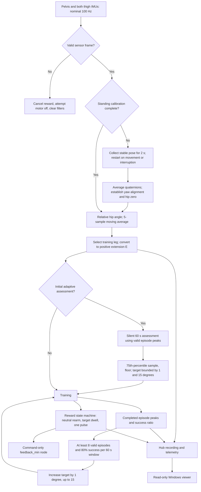

# Project logic and logic map — V19.81

[简体中文](project-logic.zh-CN.md) · [Project home](../README.md)

This document describes the actual control path in **V19.81, build 901810**, under `versions/current/App_Source/`. It is based on static inspection of source revision `846c0d6ad495233f227db48aea2e15d52c947f8e`; it does not report a new hardware test or establish clinical effectiveness. Values below are shipped defaults, not a measurement of a particular Hub session.

The Hub estimates hip motion relative to a calibrated standing pose, assesses extension ability, and issues one short vibration command per qualifying extension. A separate process uses completed extension peaks to adjust the target.

## 1. Architecture and logic map

The optional manual threshold-calibration path is disabled by default and is not expanded in this map. When enabled, it blocks training until confirmed.

| Component | Responsibility |
|---|---|
| `pelvis`, `right_thigh`, `left_thigh` | Stream posture data |
| Hub App | Validate, calibrate, compute angles, assess ability, control rewards and record |
| `feedback_min` | Receive vibration commands through the separate feedback interface |
| Windows viewer | Display App metrics and Hub status; no motor control |

The active implementation is in [current source](../versions/current/App_Source/). Root-level Python files are older implementations. [V19.7](../versions/v19.7/) is historical; [V19.9v](../probably-solve/v19.9v/) is a separate candidate awaiting hardware validation.

## 2. Standing calibration and angle calculation

[StandingCalibration](../versions/current/App_Source/standing_calibration.py) requires all three IMUs to remain stable for 2 s. Defaults allow at most 2° deviation from the first pose and 0.5° between adjacent poses. Sample discontinuity or a wall-clock interruption above 0.25 s resets collection. This tests stability, not whether the participant is anatomically upright.

Accepted quaternions are averaged. [YawCorrection](../versions/current/App_Source/YawCorrection.py) aligns initial headings to the pelvis reference, with right/left thigh offsets of +90°/−90°. These offsets assume a corresponding sensor mounting convention. The stored transform is not an ongoing drift estimator.

[JointAngles](../versions/current/App_Source/JointAngles.py) preserves natural pelvis tilt in calibration, aligns the thigh target to gravity-up with pelvis yaw, and calculates:

`q_relative = inverse(q_pelvis) × q_thigh`

Swing–twist decomposition extracts signed rotation about the configured flexion axis. Subtracting the standing offset makes the result relative to the accepted initial pose.

Both hips are calculated and smoothed with a 5-sample moving average. The default training leg is right. With `extension_direction=decreasing`, the training metric is `E = -filtered_hip_angle`: −8° raw signed angle becomes +8° extension. The field named `selected_hip_velocity` is a per-sample angle difference, not a value in degrees/second.

## 3. Assessment and valid extension episodes

Automatic assessment is enabled by default. It runs silently for 60 s after standing calibration. This differs from optional `calibration_enabled`, which is false by default; that flag does not disable standing calibration.

[ExtensionPeakCycleTracker](../versions/current/App_Source/local_peak_tracker.py) starts an episode on the positive extension side and ends it after 200 ms continuously outside that side. It detects local maxima, merges flat tops and keeps the largest candidate in an episode. A valid episode needs:

- At least 200 ms of extension-side samples.
- A detected local peak.
- A peak of at least 0.5°.

The initial target is the selected 75th-percentile sample of sorted valid peaks, rounded down, with a 1° minimum and 15° default maximum. The percentile implementation selects a sample; it does not interpolate. For example, an assessed value of 8.7° gives an 8° target.

Initial assessment does not enforce the later eight-episode minimum. With no valid peaks, it falls back to the minimum starting target. An unfinished episode at assessment end has not yet produced a completed-episode event.

## 4. Immediate reward state machine

```mermaid
stateDiagram-v2
    [*] --> WaitNeutral
    WaitNeutral --> Armed: E <= 0 continuously for 200 ms
    Armed --> Extending: E > 0; latch current target
    Extending --> Qualified: E >= latched target continuously for 30 ms
    Qualified --> Qualified: Holding extension does not retrigger
    Qualified --> Armed: E <= 0 continuously for 200 ms
    Extending --> Armed: E <= 0 continuously for 200 ms
    Armed --> WaitNeutral: Invalid data or feedback blocked
    Extending --> WaitNeutral: Invalid data or feedback blocked
    Qualified --> WaitNeutral: Invalid data or feedback blocked
```

[RewardFeedbackController](../versions/current/App_Source/reward_feedback.py) requests one 0.2 s pulse at fixed strength 2 when an episode qualifies. Duration is capped at 0.25 s, and strength must be an integer from 1 to 4. If a pulse is already active at qualification, the new pulse is suppressed. Active-pulse expiry requests motor off.

The cycle target is latched on entry into extension, preventing a target change halfway through that cycle. Starting training already in extension does not immediately earn a reward: neutral rearming is required first. Target upgrades never vibrate.

Immediate reward does not wait for the completed peak. Its dwell/rearm conditions differ from the peak-based statistical success criterion, so successful-episode count and reward count need not match.

## 5. Adaptive target progression

[AdaptiveThresholdController](../versions/current/App_Source/adaptive_threshold.py) evaluates completed valid episodes. Success means that the episode peak reaches the current target:

`success ratio = successful valid episodes / all valid episodes`

Every nominal 60 s, at least 8 valid episodes and a success ratio of at least 80% permit a 1° increase, capped at 15°. Otherwise the target remains unchanged; the default implementation does not lower it after poor performance. Evaluation waits until the peak tracker is outside an episode.

An episode is an algorithmic extension event, not independently verified ground-contact gait timing. Although phase-related fields and older strategies remain in the repository, the active reward call does not require an opposite-leg-forward state or a detected heel strike/toe off.

## 6. Recording, viewer and command semantics

[core.py](../versions/current/App_Source/core.py) records angles, targets, calibration/assessment states, episode outcomes, reward events, validity flags and command diagnostics. Vibration uses `feedback_vibration_on/off()`.

V19.81 explicitly disables feedback-node sensor monitoring. Its commands and counters do not confirm physical motor response, duration or amplitude. Retained acceleration/RMS measurement fields are unavailable placeholders. The loop closes through measured hip motion and commanded feedback, not measured motor response.

The [Windows viewer](../versions/current/fast_imu_training_viewer_v19.81.py) subscribes to 27 App metrics over WebSocket (default port 5678) and polls Hub status over HTTP (port 80). Default Hub IP is `192.168.137.1`. It displays angle/target history, command events and calibration/training state. A latest-value queue prioritizes responsiveness over retaining every sample; it is not a complete raw-data archive. Data becomes stale after approximately 2 s. Closing the viewer does not itself stop Hub control.

A separate UDP confirmation listener remains in the Hub code, enabled by default on port 50516. A valid `confirm_calibration` command can reset the threshold/adaptive workflow; the current viewer does not send that command.

## 7. Protection and interpretation limits

The current frame check rejects missing/non-finite quaternion, acceleration or gyro values and near-zero quaternions for the three posture sensors. Invalid data cancels rewards, attempts motor off and clears filtering state. Shutdown also attempts motor off.

Most timing uses sample counts at the configured 100 Hz. These nominal durations must not be treated as guaranteed wall-clock timing during missing, duplicated, delayed or replayed data. The current check does not fully validate package progression or data freshness. V19.9v introduces additional gap/recovery handling, but those candidate features are not part of V19.81.

Items requiring further validation include mounting/sign conventions, acceptance of too few assessment peaks, alignment between statistical and rewarded success, and physical motor behavior during interruptions. UI fields retained from older strategies should not be treated as proof those strategies execute in the current control path.

## 8. Default parameter reference

| Parameter | Default |
|---|---|
| Nominal sample rate | 100 Hz |
| Training side | Right |
| Standing stability duration | 2 s |
| Standing deviation / adjacent-step limit | 2° / 0.5° |
| Angle smoothing | 5 samples |
| Initial assessment / training evaluation window | 60 s / 60 s |
| Initial peak percentile / rounding | 0.75 / floor |
| Minimum starting target / upper target | 1° / 15° |
| Minimum episode duration / peak | 200 ms / 0.5° |
| Episode end and reward rearm dwell | 200 ms |
| Reward target dwell | 30 ms |
| Reward duration / cap / strength | 0.2 s / 0.25 s / 2 |
| Upgrade minimum episodes / success ratio / step | 8 / 80% / 1° |

See [config.json](../versions/current/App_Source/config.json) and [info.json](../versions/current/App_Source/info.json). A deployed Hub may contain user-modified settings.
