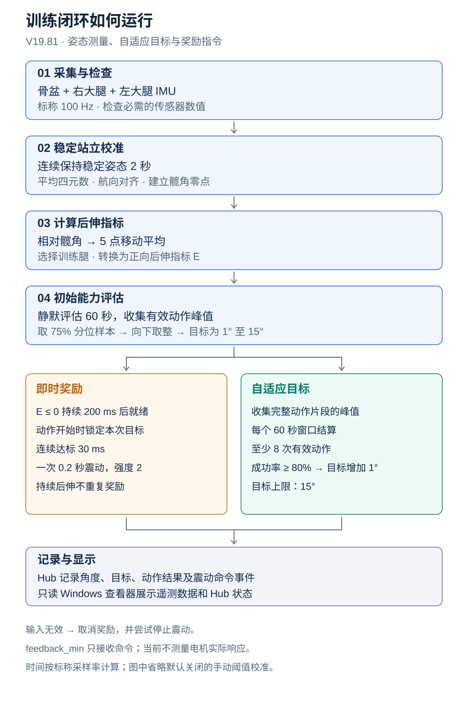
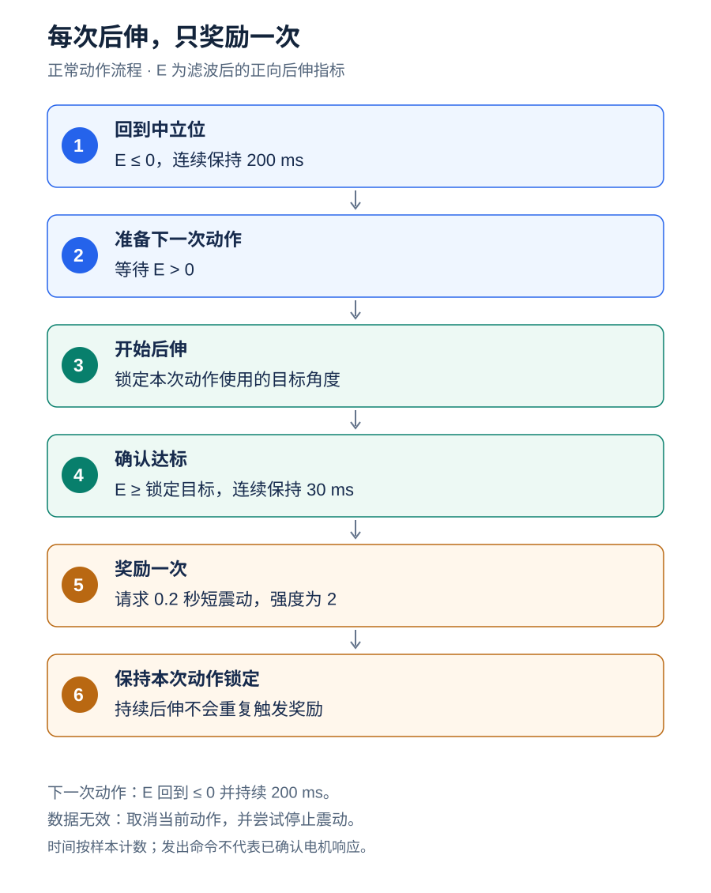

# 项目逻辑与流程图 — V19.81

[English](project-logic.md) · [项目首页](../README.zh-CN.md)

本文说明 **V19.81，build 901810** 在 `versions/current/App_Source/` 中实际执行的控制流程。依据源码版本 `846c0d6ad495233f227db48aea2e15d52c947f8e` 静态分析，未新增实机测试，也不据此证明临床效果。下述参数均为仓库默认值，不代表某次 Hub 运行的实际设置。

Hub 根据校准站姿计算相对髋角，评估后伸能力，并对每次达标后伸发出一次短震动指令。另一条流程统计完整后伸动作的峰值，用于调整目标。

## 1. 系统组成与逻辑图

[查看完整尺寸流程图](assets/project-overview.zh.svg)

默认关闭的手动训练阈值校准流程未在图中展开；启用后，它会阻止训练，直到阈值得到确认。

| 部件 | 职责 |
|---|---|
| `pelvis`、`right_thigh`、`left_thigh` | 推流姿态数据 |
| Hub App | 有效性检查、校准、角度计算、能力评估、奖励控制及记录 |
| `feedback_min` | 通过独立 feedback 接口接收震动命令 |
| Windows 查看器 | 展示 App 指标和 Hub 状态，不控制电机 |

当前实现位于[正式版源码](../versions/current/App_Source/)。根目录 Python 文件为较早实现；[V19.7](../versions/v19.7/) 为历史版本；[V19.9v](../probably-solve/v19.9v/) 是尚待实机验证的独立候选版。

## 2. 稳定站立校准与髋角计算

[StandingCalibration](../versions/current/App_Source/standing_calibration.py) 要求三颗 IMU 连续稳定 2 秒。默认相对于首个姿态偏移不超过 2°，相邻样本姿态变化不超过 0.5°。样本不连续或墙钟时间中断超过 0.25 秒，会重新采集。它检测稳定性，不独立判断受试者是否真正直立。

程序对通过检查的四元数求平均。[YawCorrection](../versions/current/App_Source/YawCorrection.py) 以骨盆为参考对齐初始航向，左右大腿分别使用 +90°、−90° 偏移。这些偏移依赖对应的传感器佩戴方向；保存的变换不是持续更新的漂移估计器。

[JointAngles](../versions/current/App_Source/JointAngles.py) 在校准时保留骨盆自然倾斜，将大腿目标对齐到重力竖直方向和骨盆航向，然后计算：

`相对四元数 = 骨盆四元数的逆 × 大腿四元数`

通过 swing–twist 分解提取预设屈伸轴上的有符号角度，再减去站立偏移，得到相对于校准姿势的髋角。

左右髋角都会计算，并使用 5 个样本的移动平均。默认选择右腿训练。配置 `extension_direction=decreasing` 时，训练指标为 `E = -滤波后髋角`，即 −8° 转为 +8° 后伸。名为 `selected_hip_velocity` 的字段是逐样本角度差，不是单位为度/秒的角速度。

## 3. 初始能力评估与有效后伸动作

默认开启自动评估，在站立校准完成后静默运行 60 秒。它与默认关闭的可选 `calibration_enabled` 流程不同；关闭该配置不会关闭站立校准。

[ExtensionPeakCycleTracker](../versions/current/App_Source/local_peak_tracker.py) 在进入正向后伸侧时开始动作片段，在离开后伸侧并连续保持 200 ms 后结束片段。它检测局部峰值、合并平顶，并取片段内最大的候选峰。有效动作需要：

- 后伸侧累计样本时长至少 200 ms。
- 至少检测到一个局部峰。
- 峰值至少 0.5°。

初始目标取排序后有效峰值的 75% 分位位置样本，向下取整，最低 1°、默认最高 15°。实现是选取样本，不做分位线性插值。例如评估值为 8.7°，目标设为 8°。

初始评估不强制满足后续升级所用的八次有效动作下限。没有有效峰时，使用最低起始目标。评估结束时尚未完成的动作片段，还没有产生完整动作事件。

## 4. 即时奖励状态机

[查看完整尺寸流程图](assets/reward-flow.zh.svg)

**E** 为滤波后的正向后伸指标。图中展示正常完成一次达标动作的主流程。

| 情况 | 控制器行为 |
|---|---|
| 30 ms 确认完成前，E 降到目标以下 | 清空达标计时，重新要求连续达标 30 ms |
| E 回到 ≤ 0 并持续 200 ms，无论本次是否获得奖励 | 重新就绪，进入下一次动作（步骤 2） |
| 动作达标时已有活动震动 | 抑制新脉冲，本次仍保持已达标状态 |
| 请求的脉冲时长到期 | 请求停震，继续保持本次动作锁定 |
| 数据无效或反馈被阻止 | 取消当前动作，尝试停震，从步骤 1 重新就绪 |

上述时间为按样本计数计算的标称时长；发出命令不代表已经确认物理震动。

[RewardFeedbackController](../versions/current/App_Source/reward_feedback.py) 在达标时请求一次 0.2 秒、固定强度 2 的短震动。时长上限为 0.25 秒；强度必须为 1–4 的整数。如果达标时已有活动震动，新脉冲被抑制。活动脉冲到期后请求停震。

进入后伸时锁定本次目标，避免动作进行到一半时改变奖励标准。刚开始训练时若已经处于后伸位，不会立即补发奖励，必须先经过中立位重新就绪。目标升级本身不震动。

即时奖励不等待动作峰值结算。它的持续达标及重新就绪条件与峰值统计不同，因此有效成功动作数不必等于实际请求奖励次数。

## 5. 自适应目标升级

[AdaptiveThresholdController](../versions/current/App_Source/adaptive_threshold.py) 根据已完成的有效动作结算。动作峰值达到当前目标即为统计成功：

`成功率 = 成功的有效动作数 / 有效动作总数`

每个标称 60 秒窗口，至少 8 次有效动作且成功率至少 80%，允许目标增加 1°，上限 15°。否则保持目标；默认实现不会因表现下降而自动降低目标。若峰值追踪器仍在动作片段内，窗口结算会等待片段结束。

这些片段是算法定义的后伸事件，没有独立验证足部接触时序。虽然仓库保留相位字段和旧策略，但当前奖励调用不要求对侧腿向前，也不要求检测到足跟着地或离地。

## 6. 记录、查看器与震动命令的含义

[core.py](../versions/current/App_Source/core.py) 记录角度、目标、校准及评估状态、动作结果、奖励事件、有效性标记和命令诊断。震动使用 `feedback_vibration_on/off()`。

V19.81 明确关闭反馈节点的传感器监测。命令及计数不证明电机真实响应、持续时间或振幅；保留的加速度/RMS 实测字段为不可用占位值。闭环由髋角测量和反馈命令构成，尚未包含对电机实际响应的测量确认。

[Windows 查看器](../versions/current/fast_imu_training_viewer_v19.81.py) 通过 WebSocket（默认 5678 端口）订阅 27 个 App 指标，并通过 HTTP（80 端口）轮询 Hub 状态。默认 Hub 地址为 `192.168.137.1`。它展示角度及目标历史、命令事件和校准/训练状态。只保留最新值的队列优先保证实时显示，不构成完整原始数据存档。约 2 秒未更新时标记数据陈旧。关闭查看器本身不会停止 Hub 控制。

Hub 代码仍保留独立 UDP 确认监听器，默认开启于 50516 端口。有效 `confirm_calibration` 命令可以重置阈值及自适应流程；当前查看器不发送该命令。

## 7. 保护措施与解释边界

当前帧检查会拒绝三颗姿态传感器缺失或非有限的四元数、加速度、陀螺仪数值，以及近零四元数。无效数据会取消奖励、尝试停震并清理滤波状态。退出时也会尝试停震。

多数计时采用配置为 100 Hz 的样本计数。在缺帧、重复、延迟或回放数据下，不能将标称时长视为有保证的墙钟时长。当前检查没有完整验证包序号推进和数据新鲜度。V19.9v 增加了缺帧及恢复处理，但候选版功能不属于 V19.81。

仍需验证：佩戴方向和角度正负号、初始有效峰过少时是否应进入训练、统计成功与奖励成功的定义是否需统一，以及中断期间电机真实行为。保留的旧策略界面字段，不代表该策略在当前控制路径中执行。

## 8. 默认参数速查

| 参数 | 默认值 |
|---|---|
| 标称采样率 | 100 Hz |
| 训练侧 | 右侧 |
| 稳定站立时长 | 2 秒 |
| 站姿偏移 / 相邻姿态变化上限 | 2° / 0.5° |
| 角度平滑 | 5 个样本 |
| 初始评估 / 训练结算窗口 | 60 秒 / 60 秒 |
| 初始峰值分位 / 取整方式 | 0.75 / 向下取整 |
| 最低起始目标 / 目标上限 | 1° / 15° |
| 最短动作后伸时长 / 最小峰值 | 200 ms / 0.5° |
| 动作结束及奖励重新就绪保持 | 200 ms |
| 达标保持时间 | 30 ms |
| 奖励时长 / 上限 / 强度 | 0.2 秒 / 0.25 秒 / 2 |
| 升级最少动作数 / 成功率 / 步长 | 8 / 80% / 1° |

参见 [config.json](../versions/current/App_Source/config.json) 和 [info.json](../versions/current/App_Source/info.json)。实际部署的 Hub 可能使用经过修改的设置。
